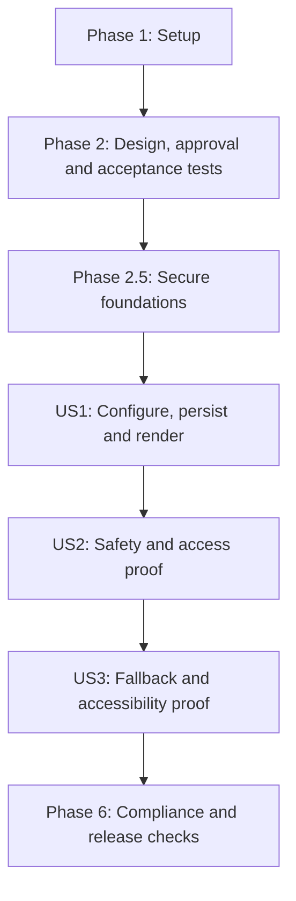

# Tasks: Configurable Third-Party Service Icons

**Input**: `specs/20261118-224349-configure-service-icons/` — `spec.md`, `plan.md`, `research.md`, `data-model.md`, `contracts/service-icons.md`, `contracts/schemas.yaml`, `quickstart.md`.
**Status**: Generated for execution; no implementation or API approval is implied. All tasks remain unchecked.
**Tests**: Mandatory under Constitution VIII/XIII and the specification's acceptance criteria. Write meaningful tests before their implementation; red-run evidence is not required. Container-backed red runs may first execute in CI when the local runtime is unavailable, without skipping assertions.
**Organization**: All three stories are P1. Implement in specification order. Shared security and image-state behavior are foundations, not controls deferred until a later story. Paths below are repository-relative; proposed new files are named explicitly.

## Feature Scope

Each task cites feature requirements/scenarios or a binding constitution principle. Implement only SVG documents owned by existing third-party services. Preserve existing authorization, row-version semantics, controls, fallbacks and cache lifetimes. No operator image URL/path, independent asset subsystem, image endpoint, new runtime configuration, Admin editor, token change, unrelated avatar redesign, or optional security bypass. No new entity boilerplate or preparatory refactoring phase is needed.

The approved implementation must follow the finite SVG vocabulary in `contracts/service-icons.md`, not merely accept arbitrary well-formed XML. Delivery uses existing authenticated JSON and `data:image/svg+xml;charset=utf-8,` plus `encodeURIComponent(source)` only at the `` rendering boundary. The payload tradeoff and SPA-wide CSP proposal require explicit review. A planning/tasks request is not stakeholder API confirmation. If approval changes the contract, reconcile these tasks and the design before coding.

## Phase 1: Setup

- [ ] T001 Confirm configured feature selection and available tools against `.specify/feature.json`, `go.mod`, `web/package.json`, `justfile` and `CONTRIBUTING.md`; read the nearest scoped instructions before touching backend, frontend or tests, and record unavailable container/browser prerequisites in `specs/20261118-224349-configure-service-icons/quickstart.md` without claiming tests ran (Constitution VIII/XIII).
- [ ] T002 Check the live sequence in `migrations/` and reserve the next unused atomic migration pair; record its exact names in `specs/20261118-224349-configure-service-icons/data-model.md` and replace candidate paths below if `migrations/049_service_icon_svg.up.sql` or `migrations/049_service_icon_svg.down.sql` is occupied; never overwrite another migration (Constitution IX).

## Phase 2: Design Preconditions — Blocking Prerequisites

No production implementation may start until this entire phase is complete. E2E test code and test-only harness work are prerequisites, not production feature implementation. Canonical API publication follows stakeholder confirmation; approval must be an actual decision, not an inferred checkbox.

### Phase 2a: Domain Model & Glossary

- [ ] T003 Document Service Icon as an optional value on the existing provider aggregate in `ARCHITECTURE.md` and its glossary; reconcile `specs/20261118-224349-configure-service-icons/data-model.md` with current provider and read-model ownership, explicitly excluding session snapshots and an icon repository (FR-003/007/009; Constitution II/V/VI).
- [ ] T004 Create and obtain acceptance of a timestamp-named SVG profile/delivery ADR under `adrs/` using the actual UTC creation timestamp; record its full file stem in `specs/20261118-224349-configure-service-icons/plan.md` and `ARCHITECTURE.md`, covering strict rejection, exact-source preservation, embedded payload cost, `` isolation and the reviewed browser policy (SR-003–SR-008; Constitution II). This requires a real acceptance decision, not automatic approval.

### Phase 2b: Configuration Design

- [ ] T005 Record the no-new-runtime-configuration/deployment conclusion in `specs/20261118-224349-configure-service-icons/plan.md`: SVG is service data submitted through Admin JSON, not a YAML setting; existing `examples/config/` and `charts/agentic-identity-broker/` remain unchanged. Verify the spec's complete Admin JSON example is the operator configuration example; do not invent YAML or Helm values (FR-001; Constitution VII).

### Phase 2c: API Design

- [ ] T006 Obtain and record explicit stakeholder confirmation in `specs/20261118-224349-configure-service-icons/contracts/service-icons.md` and `plan.md` for Admin `icon_svg`, consent `iconSvg`, catalog `icon_svg`, session `service_icon_svg`, omit/null/value semantics, agent-referenced catalog scope, embedded payload cost, legacy `logoUrl` treatment and the SPA-wide `img-src 'self' data:; object-src 'none'` proposal; preserve `frame-ancestors 'none'` and other existing controls. If confirmation is unavailable, stop implementation at this gate (FR-001–FR-015; SR-003; Constitution IV/X).
- [ ] T007 Publish the confirmed additions in `api/admin/openapi.yaml` and `api/enduser/openapi.yaml`, then regenerate their existing rendered documentation under `docs/api/`; reconcile documented `logoUrl` without silently changing its released semantics and define actual `available_services` emission for requirement/permission-set references. Specify invalid-input errors, omitted absent source and existing authentication/concurrency rules; icon-only PUT must not gain a mandatory `If-Match` precondition (FR-002/004/007/009/013/015; Constitution IV/X).

### Phase 2d: Database Design

- [ ] T008 Finalize the existing `thirdparty_oauth2_services` table extension and migration design in `specs/20261118-224349-configure-service-icons/data-model.md`: “NULL means absent; decoded UTF-8 source is 1–65,536 bytes”; use nullable text and an `octet_length` check, no backfill/timestamp rewrite, and atomic up/down SQL. Document intentional icon loss on rollback while preserving credentials and all unrelated data (FR-003; Constitution IX).

### Phase 2e: Frontend / Design System Review

- [ ] T009 Review `web/src/design-system/docs/INDEX.md`, `COMMON_MISTAKES.md`, `DECISION_TREES.md` and `DESIGN_PRINCIPLES.md`; record primitive/token choices and existing per-surface fallback behavior in `specs/20261118-224349-configure-service-icons/plan.md`. Keep composition service-specific, labels visible, images decorative and controls outside source-keyed image state; do not redesign the shared Avatar or invent a universal component (FR-008–FR-014; Constitution XI).

### Phase 2f: E2E Acceptance Test Design and Test-First Implementation

- [ ] T010 Review and reconcile the three concrete journeys, full Admin request examples and linked acceptance scenarios in `specs/20261118-224349-configure-service-icons/spec.md` with the approved OpenAPI/ADR; render changed Wireloom sources with the existing recipe and retain outputs under `specs/20261118-224349-configure-service-icons/wireframes/`. Token claims and runtime YAML changes are not applicable; do not fabricate them (Constitution XIV).
- [ ] T011 Write canonical Ginkgo cases for US1.2 and US2.4 in new `tests/e2e/service_icons_test.go`, following `plan.md`'s mapping: one complete-journey `It` per scenario, scenario reference comments and existing fixtures/authentication/production bootstrap. Assert replacement preserves the service ID, grants, session and unrelated OAuth settings; unauthenticated delivery returns no source bytes. US1.1 and US1.3 belong to T012's browser journeys, not duplicate backend acceptance cases (Constitution VIII/XIII).
- [ ] T012 Write canonical browser cases for US1.1, US1.3, US1.4, US2.1, US2.2 and US2.3 in new `tests/e2e/frontend/service_icons_test.go`; use existing Playwright/Ginkgo fixtures and page objects under `tests/e2e/pages/`. US1.1 must create/read/list through Admin, restart the broker against real PostgreSQL without reseeding, and show decoded icons beside service names in fresh consent/session views. US1.3 must show the existing icon after an omitted-field update, then each view's original fallback after explicit null and genuinely fresh data. US2.1 independently verifies persistent restart and image-mode isolation. Include zero SVG DOM insertion/execution/third-party fetch, atomic rejection and fresh replacement; extend only test-owned bootstrap support if persistent browser restart is unavailable. Use exactly one `It` per listed scenario and capture meaningful visual states (Constitution VIII/XIII; SR-002–SR-008).
- [ ] T013 Write canonical browser cases for US3.1–US3.4 in `tests/e2e/frontend/service_icons_test.go`, one `It` per scenario, covering pre-migration/no-icon services, deterministic image failure on valid stored source, fresh-source recovery without reload, narrow/wide accessibility and working connection/consent/refresh/termination controls. Configure descriptive state screenshots under `tests/e2e/screenshots/`; do not bypass server validation, depend on an imaginary image route or remount controls to force recovery (Constitution VIII/XI/XIII).
- [ ] T014 Compile the acceptance tests in `tests/e2e/service_icons_test.go` and `tests/e2e/frontend/service_icons_test.go`, verify realistic assertions fail for missing behavior where runnable, and update the 12-row mapping in `specs/20261118-224349-configure-service-icons/plan.md` to exact test names. Reject duplicate canonical mappings, placeholder assertions, pending/skipped cases or test-only production APIs; record infrastructure limits honestly in `quickstart.md` (Constitution VIII/XIII).

### Phase 2g: Observability Applicability

- [ ] T015 Confirm in `specs/20261118-224349-configure-service-icons/plan.md` that no log events, spans, attributes or metrics are added or changed; inspect existing service-write error handling against `coding-standards/LOGGING.md` and `OPENTELEMETRY.md` so submitted SVG and credentials cannot leak. If the minimal feature path requires telemetry changes, design their required safety tests/contracts/registry entries before proceeding instead of adding speculative instruments (SR-009; Constitution XV).

**Checkpoint**: Domain/ADR, no-config decision, explicit API confirmation/publication, schema design, design-system review, concrete journeys and all twelve meaningful canonical acceptance cases are complete. Approval is a human dependency; all later tasks are conditional on this checkpoint.

## Phase 2.5: Shared Secure Foundations

These are prerequisites for every production consumer, including US1. Do not ship a temporarily permissive validator or a renderer that gains safe fallback only in US3.

- [ ] T016 Write table-driven validator tests in new `internal/domain/model/service_icon_test.go` for the complete profile and every attribute-value table row in `contracts/service-icons.md`: accepted/rejected numbers, units, ranges, lists, enums, transform names/arity and deliberately lexical path/paint acceptance; exact-source preservation; “Absent or permitted source, never an empty string”; malformed/non-UTF-8 XML, root/namespace/alias/rebinding/duplicate-attribute cases, non-whitespace text, comments/directives/DOCTYPE/entities, processing instructions, scripts/events/style/links/foreign/animation and URL-bearing references. Exercise valid ASCII documents at 65,536 bytes and rejection at 65,537 bytes; use separate oversized well-formed multibyte UTF-8 fixtures to prove decoded-byte counting and size rejection before attribute validation, not valid Unicode attributes excluded by the profile (SR-002–SR-008).
- [ ] T017 Implement the strict bounded SVG validator using standard Go `encoding/xml` in new `internal/domain/model/service_icon.go`, satisfying T016 and the complete finite element/attribute/value rules in `contracts/service-icons.md`; enforce “Absent or permitted source, never an empty string” and the 65,536 decoded-byte maximum before XML/profile validation, preserve accepted source exactly, reject rather than sanitize, and perform no resource resolution/fetch. Enforce numeric/list/enum/transform rules but delegate path semantics and alphabetic color-name interpretation to the browser as explicitly specified; do not conflate blank rendering with a load error or treat parser success alone as profile validation (FR-005/006; SR-002–SR-008).
- [ ] T018 [P] Write service-specific image composition tests in new `web/src/components/services/ServiceIcon.test.tsx` for Unicode/delimiter/fragment-safe URI encoding, absent/loading/rendered/failed states, unchanged-source stability, changed-source recovery, clear/removal, empty alt text, existing caller fallbacks and preserved surrounding control state (FR-010–FR-014).
- [ ] T019 Implement the minimal source-keyed `` composition in new `web/src/components/services/ServiceIcon.tsx`, satisfying T018 with data-URL delivery only, decorative empty alt text and no keyboard stop; reset image state on changed source, discard it on clear, and delegate the caller's existing initials/placeholder/name-only fallback. Never insert markup or use `logoUrl` as a remote fallback; do not remount service actions or modify generic Avatar behavior (FR-006/010–FR-014; SR-007).
- [ ] T020 Write approved-policy regression tests in new `internal/adapters/http/handlers/spa_service_icons_test.go` for preserved security headers, allowed local/data images, prohibited remote images/object embedding and unchanged existing script/style controls; browser enforcement is also exercised by T012, not claimed from a header assertion alone (SR-003/007).
- [ ] T021 Apply only the approved image/object CSP directives in `internal/adapters/http/handlers/spa.go`, satisfying T020 while preserving `frame-ancestors 'none'`, `X-Frame-Options: DENY`, `nosniff` and any current controls. Respect the SPA-wide scope reviewed in T006; add no unrelated CSP redesign (SR-003/007; Constitution I).

**Checkpoint**: Rejection, image isolation, source-specific fallback/retry and the reviewed browser policy exist before any icon is accepted or shown. T018 may run alongside T016–T017; T020 may be authored independently after policy approval. Their implementations still depend on their own tests.

## Phase 3: User Story 1 — Configure a Service Icon from an SVG Document (P1)

**Goal**: Operators can create, read, replace, preserve and clear the source, with durable storage and current consent/session rendering.
**Independent test**: Execute US1.1–US1.4 through authorized Admin and authenticated end-user/browser paths; preserve IDs, OAuth settings, grants/sessions and full prior state on rejection. Use real PostgreSQL restart, not memory reseeding.

- [ ] T022 [US1] Add presence/type/error-envelope and create/update/detail/list contract tests in new `internal/adapters/http/handlers/admin/service_icons_test.go`: “Three distinct states: absent, null, value”; omit preserves, null clears, valid string replaces and invalid type/value rejects the entire write. Assert existing auth/row-version behavior and no newly mandatory `If-Match` on icon-only PUT (FR-001/002/004/013/015; US1.1–US1.4).
- [ ] T023 [P] [US1] Add domain write-path tests in new `internal/domain/thirdparty/service_icons_test.go`: reject before discovery/credential transformations/persistence, do not mutate memory-backed state on failure, and preserve omitted source in actual `prepareUpdate`/`Update`, not just `ValidateUpdate`'s copy (FR-004/013/015; US1.2–US1.4).
- [ ] T024 [P] [US1] Add adapter-parity tests in new `internal/adapters/storage/memory/service_icons_test.go`, repository round-trip tests in new `tests/integration/storage/service_icons_test.go` and production-chain migration tests in new `tests/integration/migrations/service_icons_migration_test.go`: null/replace/clear, exact source, two independent services sharing identical source, reconnect durability, pre-existing timestamps/data unchanged, and atomic up/down/up preserving unrelated data (FR-003; US1.1/1.3; Constitution IX).
- [ ] T025 [US1] Extend `internal/domain/model/thirdparty_oauth2_provider.go` with optional source and transient request-presence state implementing “Three distinct states: absent, null, value”; validate a separate candidate and merge preserve/clear/replace in the persisted `prepareUpdate`/`Update` flow in `internal/domain/thirdparty/service.go`, invoking T017 before side effects. Keep service IDs, existing credentials/configuration and concurrency semantics intact (FR-001/004/013/015).
- [ ] T026 [US1] Create the T002-reserved atomic pair, candidate `migrations/049_service_icon_svg.up.sql` and `migrations/049_service_icon_svg.down.sql`, adding nullable `icon_svg` text/check on `thirdparty_oauth2_services`: “NULL means absent; decoded UTF-8 source is 1–65,536 bytes”. No backfill/default or timestamp rewrite; rollback drops only the new check/column (FR-003; Constitution IX).
- [ ] T027 [US1] Carry source through `internal/adapters/storage/memory/thirdparty_provider.go` and `thirdparty_provider_record.go`, clearing transient request flags and retaining independent copies; update `internal/adapters/storage/postgres/thirdparty_provider.go` and `thirdparty_provider_record.go` conversions and every explicit INSERT/UPDATE/SELECT/RETURNING column list. Keep row locking/version checks and existing repository ports (FR-003/015; T024).
- [ ] T028 [US1] Extend presence-aware `ServiceRequest.UnmarshalJSON`, request mapping and Admin create/update/detail/list responses in `internal/adapters/http/handlers/admin/services_handler.go`; expose `icon_svg` only when present, preserve existing error/auth behavior and require no new icon-only client precondition. Satisfy T022/T023 against real persistence behavior rather than echoing request input (FR-001/002/004/013/015).
- [ ] T029 [US1] Write current-metadata projection tests in new `internal/domain/consent/service_icons_test.go` and `internal/domain/oauth2session/service_icons_test.go`, plus handler serialization tests in new `internal/adapters/http/handlers/consent/service_icons_test.go`: scoped/mandatory/optional services, permission-set-only catalog, list/detail/refresh summaries, replacement and clearing without session snapshots or unrelated service exposure (FR-007/009/012).
- [ ] T030 [US1] Populate current sources in `internal/domain/consent/service.go` and `internal/adapters/http/handlers/consent/agent_detail_handler.go`; emit deduplicated redacted `available_services` covering this agent's requirements and assigned permission sets, using “Agent-referenced requirements and permission-set services, redacted and deduplicated”. Carry consent `iconSvg`/catalog `icon_svg`; do not copy source into individual permission-set scopes or list unrelated administrative services (FR-007/008; T029).
- [ ] T031 [US1] Add `service_icon_svg` to the shared summary in `internal/domain/storage/user_session.go` and populate list/detail/summary-returning refresh paths in `internal/domain/oauth2session/service.go`: “Current referenced service source, not a session snapshot”. Reuse existing provider lookups/batches instead of one query per occurrence and omit cleared source (FR-009/012; T029).
- [ ] T032 [US1] Write caller-specific consent integration unit tests before T034/T035 in `web/src/components/consent/ServiceCard.test.tsx` and `PermissionSetCard.test.tsx`, plus API mapping tests in `web/src/services/api/consent.test.ts`: original fallbacks, permission-set-only catalog propagation, failed-to-valid/failed-to-absent transitions, omitted/null metadata replacing stale values, unchanged-source rerenders and retained consent/connection control state. Reuse T018's shared image-state coverage; these tests must compile and fail semantically before caller implementation, not wait until US3 (FR-007/008/010–FR-014; Constitution VIII).
- [ ] T033 [P] [US1] Write session caller/mapping unit tests before T034/T035 in `web/src/components/sessions/SessionCard.test.tsx`, new `web/src/components/sessions/TerminationDialog.test.tsx` and `web/src/services/api/sessions.test.ts`; assert current/cleared source mapping, original name-only fallback, refresh/termination behavior, unchanged confirmation prose, decorative images and retained control state through failures/replacement. Tests must compile and fail semantically before integration (FR-009/010/014; Constitution VIII).
- [ ] T034 [US1] After T032/T033, propagate approved optional fields through `web/src/types/consent.ts`, `web/src/services/api/consent.ts`, `web/src/services/api/sessions.ts` and the available-service mapping in `web/src/pages/AgentGrantDetailPage.tsx`; retain `available_services` instead of deriving permission-set identities solely from requirement services. Tolerate omitted/null values without merging stale cleared metadata; retain existing five-/two-minute API cache lifetimes (FR-007/009/012).
- [ ] T035 [US1] After T032–T034, integrate T019 into `web/src/components/consent/ServiceCard.tsx`, `PermissionSetsList.tsx`, `PermissionSetCard.tsx`, `web/src/components/sessions/SessionCard.tsx`, `TerminationDialog.tsx` and `web/src/pages/ThirdPartySessionsPage.tsx`; decorate service identity labels only, including the live mandatory/optional requirement path. Preserve names, original per-surface fallbacks and all controls; do not modify unused requirement components solely for their names. Turn the caller tests green without weakening expectations (FR-008–FR-014; Constitution VIII).

**Checkpoint**: Run the focused US1 cases written in T011/T012 and the matching unit/integration tests after `just check` for Go/test changes; observe actual consent/session surfaces. This is the proposed first usable increment, not completion of the entire feature. Security foundations cannot be removed from it.

## Phase 4: User Story 2 — Supply a Safe SVG Icon (P1)

**Goal**: Prove accepted-source fidelity and image-mode isolation while rejecting unsafe input atomically and protecting every delivery path.
**Independent test**: Execute US2.1–US2.4 against production bootstrap and a real browser, with persistent restart, request/execution observation, fresh replacement and unauthenticated denial. Core safety already exists in foundations/US1.

- [ ] T036 [US2] Complete adversarial domain coverage in `internal/domain/model/service_icon_test.go` against every allowed element/attribute/value restriction from `contracts/service-icons.md`, including the numeric/list/enum/transform and path lexical rules, namespace rebinding, duplicate attributes, encoded URL/entity tricks, optional initial UTF-8 declaration and byte-boundary inputs. Add only missing behavior coverage, not source-text or echo assertions; new regressions precede fixes (SR-004–SR-008; US2.3).
- [ ] T037 [P] [US2] Add safety/authentication/atomicity contract coverage in `internal/adapters/http/handlers/admin/service_icons_test.go` and `tests/integration/storage/service_icons_test.go`: rejected writes with simultaneous credential/metadata changes leave complete stored state intact; end-user routes cannot write; existing authenticated consent/session ownership boundaries disclose no source to unauthorized callers (SR-001/008; FR-013/015; US2.3/2.4).
- [ ] T038 [US2] Drive T012's US2.1/US2.3 browser assertions in `tests/e2e/frontend/service_icons_test.go` through the built SPA: verify real image decoding, absence of inserted SVG DOM/execution, no third-party requests and no availability of rejected source after persistent restart/rejection. Use existing synthetic providers/network observation, not a new remote-image service; fix any revealed defect at its shared root in `internal/domain/model/service_icon.go` or `web/src/components/services/ServiceIcon.tsx` before proceeding (FR-005/006; SR-002–SR-008).
- [ ] T039 [US2] Exercise US2.2 in `tests/e2e/frontend/service_icons_test.go` across consent/catalog/requirements/session list/detail with two services sharing identical source; replace only one, observe genuinely fresh metadata through supported cache expiration/invalidation, and assert the current source replaces its predecessor while the other service is unchanged. Fix mapping defects in `web/src/services/api/consent.ts` or `sessions.ts` without changing cache lifetimes or adding revision/asset infrastructure (FR-011/012/015).
- [ ] T040 [US2] Review T011's US2.4 assertions in `tests/e2e/service_icons_test.go` against every actual delivery response, including summary-returning refresh routes when applicable; use existing failure statuses and verify absence of source bytes. Retain existing principal/ownership enforcement, introduce no alternate icon route, and correct only feature-path disclosure failures (SR-001; US2.4).
- [ ] T041 [US2] Run focused validator, write-atomicity, PostgreSQL and US2 acceptance/browser checks using the existing `justfile` recipes; record actual outcomes and built-SPA security-header/network evidence in `specs/20261118-224349-configure-service-icons/quickstart.md`, clearly distinguishing unavailable infrastructure from successful verification (SC-002/005; Constitution VIII/XIII).

**Checkpoint**: All four US2 canonical scenarios pass; an `` tag alone is not proof of validation, isolation or zero external loads. Any gap discovered here blocks delivery and is not deferred.

## Phase 5: User Story 3 — Keep Service Views Usable Without an Image (P1)

**Goal**: Prove unchanged fallback/control behavior, source-specific recovery and accessible identity across every affected view.
**Independent test**: Execute US3.1–US3.4 on an open page with absent, loading, failed, recovered and removed sources at narrow/wide viewports; no reload, lost control state, page-level image error, extra focus stop or duplicate announcement.

- [ ] T042 [US3] Exercise T013's deterministic browser failure/recovery in `tests/e2e/frontend/service_icons_test.go` against valid stored SVG; trigger the existing data-refresh path and observe a fresh response, then verify a successful new load without page reload or remounted controls. Correct only shared image-state defects in `web/src/components/services/ServiceIcon.tsx` and metadata mapping defects in `web/src/services/api/consent.ts` or `sessions.ts`; do not bypass existing caches to disguise stale data (FR-010–FR-012; US3.2/3.3).
- [ ] T043 [US3] Verify pre-feature/no-icon and cleared-source behavior in `tests/e2e/frontend/service_icons_test.go` on service cards, permission-set rows, live requirement rows, session cards and the termination detail header; assert working connection, consent, refresh and termination actions, no broken-image marker and no page-level error, correcting only affected caller composition from T035 when necessary (FR-008–FR-010; US3.1/3.2).
- [ ] T044 [US3] Complete US3.4 keyboard/accessibility and narrow/wide checks in `tests/e2e/frontend/service_icons_test.go` using page objects under `tests/e2e/pages/`; verify one readable service name, empty image alt, zero extra focus stops, noninteractive decoration and existing semantic-token/WCAG 2.1 AA layout. Capture exercised configured/unset/failed/recovered states to descriptive files in `tests/e2e/screenshots/` (FR-014; SC-003/004/006; Constitution XI/XIII).
- [ ] T045 [US3] Run focused frontend unit and US3 browser checks through `justfile`, including repeated maximum-size accepted sources without introducing a benchmark subsystem; record observed outcomes and screenshot paths in `specs/20261118-224349-configure-service-icons/quickstart.md` and confirm no generic avatar/control redesign slipped into the feature (SC-001/003/004/006).

**Checkpoint**: All four US3 canonical scenarios pass on the actual UI. Foundational fallback/retry behavior has been verified, not postponed to a later release.

## Phase 6: Polish and Constitution Compliance Verification

### Design Phase Verification

- [ ] T046 Verify approval/ADR evidence, Service Icon glossary/model, configuration non-applicability, migration design, design-system review and concrete journey/Wireloom consistency in `ARCHITECTURE.md` and `specs/20261118-224349-configure-service-icons/plan.md`; ensure every task still traces to an approved requirement or binding constraint and exclude unrelated remediation (Constitution II/V/VII/IX/X/XI/XIV).
- [ ] T047 Verify exact implementation/schema/example parity in `api/admin/openapi.yaml`, `api/enduser/openapi.yaml`, rendered `docs/api/` and `specs/20261118-224349-configure-service-icons/contracts/`; confirm absent/null handling, field casing, redacted catalog scope, legacy `logoUrl` disposition, current session summaries, existing auth and no new icon-only mandatory `If-Match` (Constitution IV/X; FR-002/004/007/009/015).

### Implementation Phase Verification

- [ ] T048 Verify nullable-byte constraints and every explicit SQL conversion/query in `internal/adapters/storage/postgres/thirdparty_provider.go`, memory parity in `internal/adapters/storage/memory/thirdparty_provider_record.go`, sequential atomic SQL in `migrations/` and apply/down/up/reconnect/restart evidence in `tests/integration/migrations/service_icons_migration_test.go` and `tests/integration/storage/service_icons_test.go`; retain unrelated data and no session snapshot/N+1 behavior (Constitution IX; FR-003/009/015).
- [ ] T049 Review feature changes against `coding-standards/LOGGING.md`, `coding-standards/OPENTELEMETRY.md` and other applicable standards; verify no source/credentials/personal data in error telemetry, no custom crypto, suppressed checks, unsafe bypass, adapter-to-adapter coupling or port bypass. Record checklist results in `specs/20261118-224349-configure-service-icons/plan.md`; if telemetry changed, complete required safety tests/contracts/registry entries rather than asserting non-applicability (SR-009; Constitution I/III/VI/XV).
- [ ] T050 Audit exactly twelve canonical scenario-linked Ginkgo `It` cases across `tests/e2e/service_icons_test.go` and `tests/e2e/frontend/service_icons_test.go` against `spec.md` and `plan.md`; verify tests preceded behavior, no pending/skip/placeholder assertions, realistic complete journeys and no weakened expectations. Verify frontend screenshot paths and all service surfaces are covered; supplemental unit/integration cases are not duplicate acceptance mappings (Constitution VIII/XIII).
- [ ] T051 Run `just check` then the smallest affected backend/frontend tests and production PostgreSQL migration/repository and browser acceptance suites using `justfile` and `quickstart.md`; run required `just verify` before PR per `CONTRIBUTING.md`, recording actual commands/results and infrastructure limits in `specs/20261118-224349-configure-service-icons/quickstart.md`. Do not claim unrun gates passed (Constitution VIII/IX/XIII).
- [ ] T052 Update operator/API usage and final verification evidence in rendered `docs/api/`, `ARCHITECTURE.md` and `specs/20261118-224349-configure-service-icons/quickstart.md`; include the existing repository changelog if one is maintained, remove only feature-created throwaway artifacts, verify the accepted ADR matches final behavior and run scoped quality-delta before declaring completion. Do not create unrelated documentation or commit without a request (Constitution II/IV; SC-001–SC-006).

## Dependencies & Execution Order

- T001 precedes all scoped work. T002 fixes migration names before schema implementation. Design subphases may proceed independently except T007 follows T006, T010–T014 follow finalized contracts, and T014 follows T011–T013. T012 and T013 own the same browser file and must be sequential.
- All of Phase 2 gates production implementation, especially T004 acceptance and T006 API/policy approval. Do not claim those external decisions are completed by generating this file.
- Foundations: T016 → T017; T018 → T019; T020 → T021. Independent test authoring can overlap; no implementation precedes its own tests. Secure validation/rendering/policy are shared and must be present before enabling an icon path.
- US1: T022–T024 test different slices; T025 follows domain/handler tests; T026 follows reserved schema design; T027 follows T024–T026; T028 follows persistence. T029 precedes T030/T031. T032/T033 are disjoint caller/mapping unit-test tasks and must compile and fail semantically before T034 API-client mapping and T035 UI integration. Both projections and frontend renderer foundations must be ready for T034 → T035. Do not defer caller tests to US3.
- US2 depends on US1's real write/read/UI path, not an unsafe provisional implementation. T036 and T037 are independent focused test slices; T038–T040 exercise browser/acceptance surfaces and should be integrated serially. Core validation is not deferred from US1 to US2.
- US3 depends on the same delivered image path and on caller unit tests already written in T032/T033 and green in US1. T042–T044 share the canonical browser file and run serially; they prove the existing behavior rather than introducing its baseline unit tests after implementation. Any newly discovered defect gets a failing regression before its fix.
- All stories are P1; this dependency order reflects their overlapping end-to-end acceptance requirements, not lower priority for safety or fallback. Phase 6 requires every story, not merely the MVP. Run broad release gates once after integration; focused checks belong at their corresponding checkpoints.

## Parallel Execution Examples

### US1

After foundations, author T022 Admin contract tests, T023 domain atomicity tests and T024 memory/PostgreSQL/migration tests in parallel: their owned files do not overlap. After T029, consent projection T030 and session projection T031 can proceed in parallel if shared type edits have one owner. T032 consent caller/mapping tests and T033 session caller/mapping tests also have disjoint files and can be authored in parallel, but both precede T034/T035. Do not parallelize T025/T028 or the client/UI integration against unsettled fields.

### US2

After US1, author T036 validator adversarial cases and T037 handler/storage safety cases in parallel. Keep T038/T039 browser work under one owner because both edit `tests/e2e/frontend/service_icons_test.go`. Browser and backend checks can run concurrently only with isolated harness storage and no shared fixtures.

### US3

Baseline consent/session caller unit tests were already parallelized as T032/T033 before US1 integration. In US3, run those existing Vitest tests independently of the isolated browser suite; serialize T042–T044 browser changes and screenshot updates. Shared `ServiceIcon.tsx` corrections belong to one owner and require a failing regression before the fix.

`[P]` means disjoint ownership and no dependency on the concurrently active task, not permission to skip preceding phase gates or that task's own test-first prerequisite. Phase-2 review work may be scheduled concurrently only when its document edits do not overlap.

## Implementation Strategy

1. Complete setup and all design gates, including real stakeholder approval and test-first canonical journeys. No production behavior changes while approval is outstanding.
2. Build the rejection, source-keyed rendering/fallback and reviewed-policy foundations. There is no permissive interim mode.
3. Deliver US1 as the suggested first usable increment: configure/persist/current projections plus every required identity surface, already protected by validation/authentication and safe fallback. Demonstrate it with focused tests and real PostgreSQL restart. This is not permission to declare the feature complete without US2/US3.
4. Complete US2's adversarial/access/isolation proof and US3's failure-recovery/accessibility proof; fix failures before moving on. Preserve all twelve scenario mappings rather than weakening a checkpoint to ship.
5. Complete constitution verification, rendered API/operator documentation and the repository release gate. Report actual evidence only. Commit/push remains a separate requested action.
